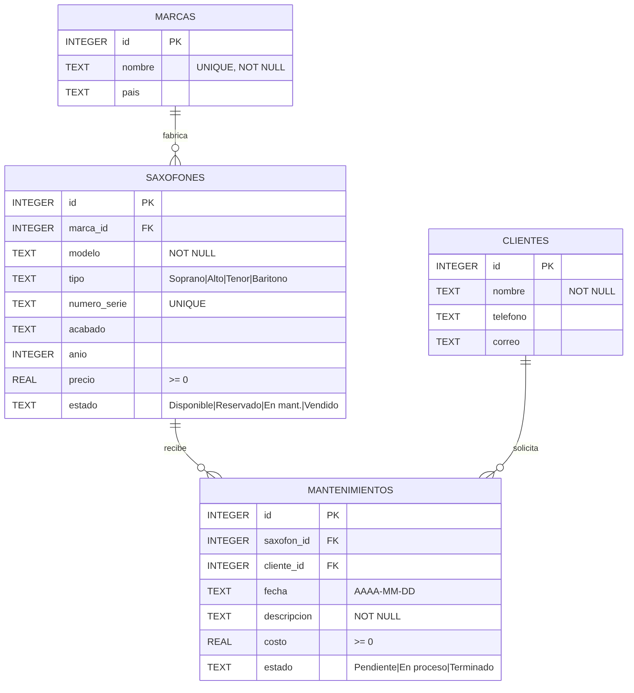

# 🎷 SaxManager

Sistema web para administrar el **inventario y el taller de reparación** de una tienda de saxofones.

Proyecto del curso de desarrollo web con **Python, FastAPI y SQLite**.

---

## 1. Análisis

### Problema
Las tiendas pequeñas de instrumentos de viento suelen llevar el inventario de saxofones y los trabajos de taller en cuadernos u hojas de Excel sueltas. Eso provoca que:
- no se sepa con certeza qué saxofones están disponibles, reservados, vendidos o en reparación;
- se pierda el historial de reparaciones de cada instrumento (por número de serie);
- no haya un registro claro de qué cliente trajo qué instrumento ni cuánto se le cobró.

### Objetivo general
Desarrollar una aplicación web que permita registrar, consultar, modificar y eliminar la información de saxofones, marcas, clientes y servicios de taller, almacenándola en una base de datos SQLite y accediendo a ella mediante una API hecha con FastAPI.

### Funcionalidades principales
- **Inicio / resumen:** total de saxofones, disponibles, en taller, servicios activos y valor del inventario.
- **Saxofones:** CRUD completo, búsqueda por modelo/serie/marca y filtros por tipo y estado.
- **Marcas:** CRUD, con conteo de saxofones por marca.
- **Clientes:** CRUD, con conteo de servicios por cliente.
- **Taller (mantenimientos):** CRUD de servicios que relacionan un saxofón con un cliente.
- **Validaciones:** número de serie único, precio/costo no negativos, tipos y estados válidos, y protección para no borrar registros con dependencias.

### Usuarios
- **Encargado/vendedor de la tienda:** gestiona inventario y estado de los saxofones.
- **Técnico del taller:** registra y actualiza los servicios de mantenimiento.
- **Administrador:** mantiene el catálogo de marcas y clientes.

---

## 2. Diseño de la base de datos



### Tablas

| Tabla | Descripción | PK | FK |
|---|---|---|---|
| `marcas` | Fabricantes de saxofones (Yamaha, Selmer…) | `id` | — |
| `saxofones` | Inventario: modelo, tipo, serie, precio, estado | `id` | `marca_id → marcas.id` |
| `clientes` | Personas o instituciones que compran o llevan instrumentos al taller | `id` | — |
| `mantenimientos` | Servicios de taller realizados a un saxofón para un cliente | `id` | `saxofon_id → saxofones.id`, `cliente_id → clientes.id` |

### Relaciones
- **marcas 1 — N saxofones:** una marca tiene muchos saxofones; cada saxofón es de una sola marca. `ON DELETE RESTRICT`: no se puede borrar una marca que tenga saxofones.
- **saxofones 1 — N mantenimientos:** un saxofón puede tener muchos servicios. `ON DELETE CASCADE`: si se borra el saxofón se borra su historial.
- **clientes 1 — N mantenimientos:** un cliente puede solicitar muchos servicios. `ON DELETE RESTRICT`: no se puede borrar un cliente con servicios registrados.

El script completo está en [`database/schema.sql`](database/schema.sql) y los datos de ejemplo en [`database/seed.sql`](database/seed.sql).

---

## 3. Tecnologías

| Capa | Tecnología |
|---|---|
| Backend | Python 3 + FastAPI |
| Validación | Pydantic |
| Base de datos | SQLite (módulo `sqlite3` de Python) |
| Frontend | HTML, CSS y JavaScript (fetch) |
| Control de versiones | Git + GitHub |
| Publicación | Vercel |

---

## 4. Estructura del proyecto

```
saxmanager/
├── api/
│   └── index.py            # Punto de entrada para Vercel
├── app/
│   ├── main.py             # Crea la app FastAPI, registra rutas y sirve el frontend
│   ├── database.py         # Conexión a SQLite y creación de la base
│   ├── schemas.py          # Modelos Pydantic (validación de datos)
│   ├── errores.py          # Traduce errores de SQLite a respuestas HTTP
│   └── routers/
│       ├── marcas.py
│       ├── saxofones.py
│       ├── clientes.py
│       └── mantenimientos.py
├── database/
│   ├── schema.sql          # Estructura de las tablas
│   ├── seed.sql            # Datos de ejemplo
│   └── saxofones.db        # Base de datos SQLite
├── frontend/
│   ├── index.html
│   ├── css/styles.css
│   └── js/
│       ├── api.js          # Funciones que llaman a la API
│       └── app.js          # Lógica de la interfaz
├── docs/
│   ├── diagrama_er.png
│   └── diagrama_er.mmd     # Código fuente del diagrama (Mermaid)
├── requirements.txt
├── vercel.json
├── .gitignore
└── README.md
```

**Flujo:** `Frontend (fetch) → API FastAPI (/api/...) → SQLite`

---

## 5. Endpoints de la API

Documentación interactiva automática en `/docs` (Swagger).

| Método | Ruta | Descripción |
|---|---|---|
| GET | `/api/saxofones` | Lista (filtros opcionales `?tipo=&estado=&buscar=`) |
| GET | `/api/saxofones/resumen` | Datos del panel de inicio |
| GET | `/api/saxofones/{id}` | Un saxofón |
| POST | `/api/saxofones` | Crear |
| PUT | `/api/saxofones/{id}` | Modificar |
| DELETE | `/api/saxofones/{id}` | Eliminar |
| GET / POST | `/api/marcas` | Listar / crear |
| GET / PUT / DELETE | `/api/marcas/{id}` | Ver / modificar / eliminar |
| GET / POST | `/api/clientes` | Listar / crear |
| GET / PUT / DELETE | `/api/clientes/{id}` | Ver / modificar / eliminar |
| GET / POST | `/api/mantenimientos` | Listar / crear |
| GET / PUT / DELETE | `/api/mantenimientos/{id}` | Ver / modificar / eliminar |

**Manejo de errores:**
- `404` el registro no existe
- `409` número de serie o nombre de marca repetido, o se intenta borrar algo con dependencias
- `400` se referencia una marca/saxofón/cliente que no existe
- `422` datos inválidos (validación de Pydantic)

---

## 6. Instalación y ejecución local

```bash
# 1. Clonar el repositorio
git clone https://github.com/USUARIO/saxmanager.git
cd saxmanager

# 2. Crear y activar entorno virtual
python -m venv venv
venv\Scripts\activate        # Windows
source venv/bin/activate     # Mac / Linux

# 3. Instalar dependencias
pip install -r requirements.txt

# 4. Ejecutar
uvicorn app.main:app --reload
```

Abrir:
- Aplicación: http://127.0.0.1:8000
- Documentación de la API: http://127.0.0.1:8000/docs

> Si se borra `database/saxofones.db`, al iniciar el servidor se vuelve a crear automáticamente a partir de `schema.sql` y `seed.sql`.

---


